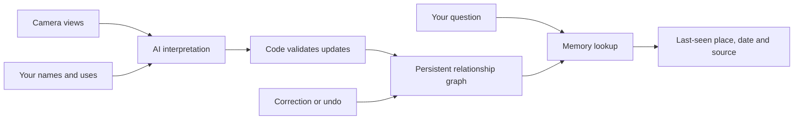

# Environment Memory

**[Watch the demo on YouTube — 2:37](https://youtu.be/qmXjGuRalUo)**

[](https://youtu.be/qmXjGuRalUo)

**Show your space. Add your meaning. Find where you last left things.**

Environment Memory is a mobile web prototype that connects what a camera sees
with the names, groups and uses you remember. AI proposes objects and relationships;
application code validates updates and saves a graph of dated observations,
probable identities and your own meaning. Ask where something was last seen and
inspect the image behind the answer.

## The demonstrated journey

1. Start a scan and move around a fictional workbench. Useful views are saved automatically.
2. Select the screwdriver in the live object list.
3. Teach it a name, a project and a use: **my electronics screwdriver**, **Robot project**, **servo mounting screws**.
4. Ask **“Where is my electronics screwdriver?”**
5. Open the dated source image to see where it was last recorded.

The English demo is **2:37, 1920 × 1080**. It shows recorded UI interactions and
an explanatory relationship graph. Recognition and natural-language teaching in
that recording used live AI; the free quick start below deliberately runs with
recognition disabled. No recorded inventory or personal photos are bundled.

## Quick start — no API key or paid calls

Requires Node.js **24–26**, npm and Python **3.10+** for checks.
Install/start/build/test commands check the Node version before loading the app.
If you use nvm, run `nvm install && nvm use` in this directory first.

```sh
npm ci
npm run build:demo
npm run demo
# Open http://127.0.0.1:7460/mobile
```

The preview starts with empty memory. Explore the workshop, start scanning and
save views. **It does not recognize objects until a provider is configured.**
Runtime data stays in ignored `data/mobile-preview/`. This is the same application
code, not a prefilled simulation of AI results.

```sh
npm run check
```

See [setup and live AI](docs/setup.md) for a bounded provider-enabled session,
[Android camera](docs/android.md) for real camera capture, and
[agent tools](docs/agents.md) for HTTP/MCP integration.

## What is included

- Mobile camera interface and expandable object list.
- Automatic view capture; a fictional procedural workshop for repeatable development.
- Image interpretation and natural-language edits through a server-side provider.
- Persistent object, observation, support and containment relationships.
- Personal names, groups, tags, correction and undo.
- Source-linked, dated answers; unique exact-name lookup can run without an AI call.
- Compact HTTP/MCP tools, offline tests and explicit request/frame/cost limits.

## Architecture



React, TypeScript and Three.js power the client; Fastify, Zod and Node SQLite
handle the server and validated persistence. See [architecture](docs/architecture.md).

## Current limits

This is a prototype, not a packaged Android app. Real-object camera tests have
worked, but broad device and real-world reliability are not established. Similar
objects can be confused; a probable match is reversible. An unseen object is not
necessarily missing. The recorded location is not a guarantee of its current location.

The virtual scene never writes its hidden object identities or movements into
memory. Recognition uses saved images. Optional local-agent relays and speech
bridges require separate setup; no local model or speech weights are shipped.
Closed-container relocation remains experimental and is not a success claim of
the main demo. See [limitations and test scope](docs/verification.md).

## Privacy and license

The source distribution contains **no personal photos, saved captures, credentials,
runtime databases, model responses, budget ledgers or local experiment logs**.
Live AI sends selected images and relevant history to the configured provider;
use only images you are willing to share. Keep the server on localhost.

Project source is [MIT licensed](LICENSE). Dependencies and external model services
retain their own terms: [third-party notices](THIRD_PARTY_NOTICES.md).
See [contributing](CONTRIBUTING.md) and [security](SECURITY.md).
